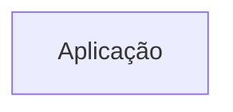
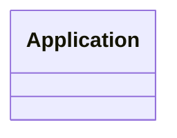
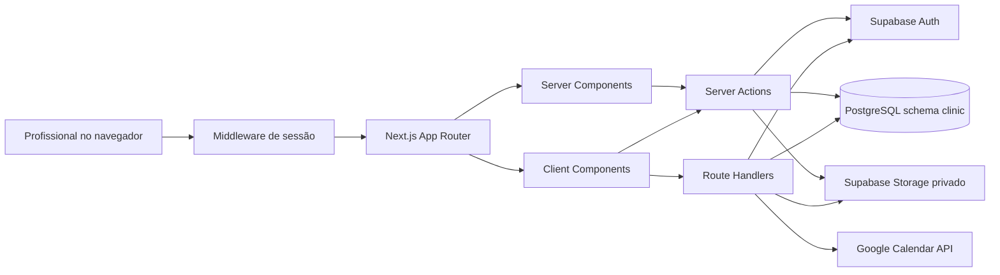
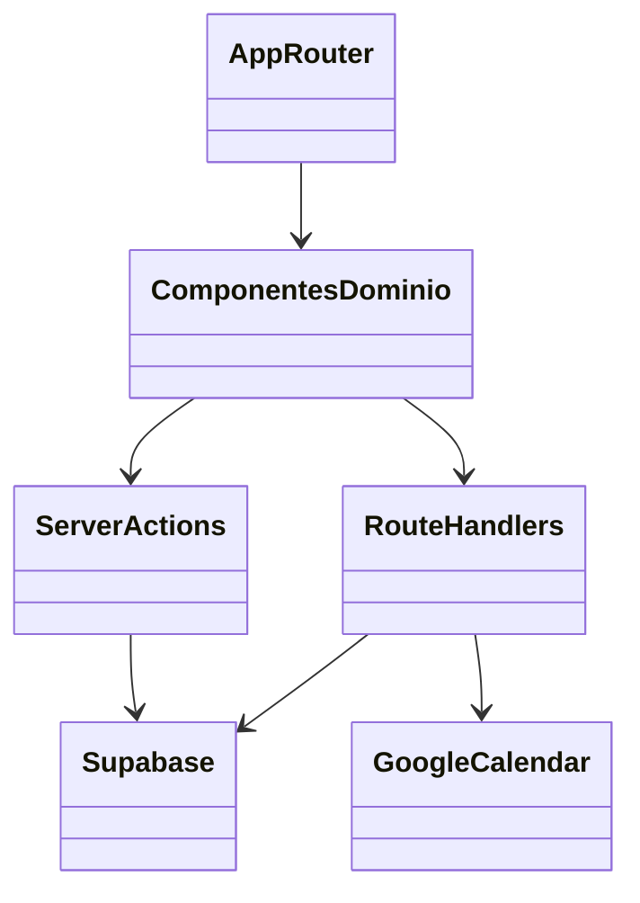

# Arquitetura

<!-- specsfy:documentator:start -->
## Componentes

| Tipo | Quantidade |
| --- | --- |
| Código | 1369 |
| Testes | 0 |

## Diagramas

<!-- specsfy:documentator:end -->

## Complemento auditado

O produto é um monólito modular Next.js. O App Router coordena páginas e
layouts; componentes de domínio implementam interação; Server Actions e Route
Handlers acessam Supabase e integrações externas. O tenant é resolvido pelo
perfil autenticado e reaplicado em queries, storage paths e RLS.

O build é `standalone`, empacotado em imagem Docker multi-stage. Releases usam
`hygorfragas/clinica:<semver>` para `linux/amd64`.
