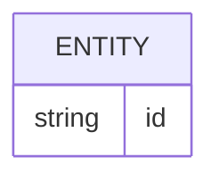

# Banco de dados

<!-- specsfy:documentator:start -->
## Fontes de persistência

| Arquivo |
| --- |
| components/setup/cadastro-migration-required.tsx |
| supabase/manual/01_clinic_bootstrap_status.sql |
| supabase/migrations/20260321195600_initial_multitenant_clinic_schema.sql |
| supabase/migrations/20260321203000_platform_super_admin_rls.sql |
| supabase/migrations/20260322120000_tenant_managers_and_platform_super_admins.sql |
| supabase/migrations/20260323120000_fix_profiles_select_rls_recursion.sql |
| supabase/migrations/20260407130000_owner_is_superadmin.sql |
| supabase/migrations/20260407150000_clinical_storage_bucket.sql |
| supabase/migrations/20260407160000_photos_body_region_capture_angle.sql |
| supabase/migrations/20260407180000_contract_templates_and_document_body.sql |
| supabase/migrations/20260407190000_clients_hidden_from_ui.sql |
| supabase/migrations/20260407200000_professional_stamp_clients_cpf_documents_responsible.sql |
| supabase/migrations/20260408120000_client_procedure_purchases_photo_links.sql |
| supabase/migrations/20260418120000_agenda_google_calendar.sql |
| supabase/migrations/20260418130000_anamnesis_templates_and_submissions.sql |
| supabase/migrations/20260418140000_evolutions_procedures_and_photos.sql |
| supabase/migrations/20260418150000_inventory_and_procedure_pricing.sql |
| supabase/migrations/20260418193000_grant_agenda_anamnesis_tables.sql |
| supabase/migrations/20260418210000_google_oauth_credentials_in_calendar_settings.sql |
| supabase/migrations/20260419120000_clinic_document_branding.sql |
| supabase/migrations/20260420120000_user_theme_preferences.sql |
| supabase/migrations/20260421120000_budgets_auto_cancel.sql |
| supabase/migrations/20260501120000_contract_templates_form_schema.sql |
| supabase/migrations/20260501150000_financial_module.sql |
| supabase/migrations/20260502120000_evolution_templates_and_submissions.sql |
| supabase/migrations/20260502130000_dashboard_phrases.sql |
| supabase/migrations/20260502140000_contract_submissions.sql |
| supabase/migrations/20260525120000_photos_evolution_submission_link.sql |
| supabase/migrations/20260627120000_photos_captured_at.sql |
| supabase/migrations/20260801120000_procedure_bom_items.sql |
| supabase/migrations/20260801123000_consume_appointment_stock_atomic.sql |
| supabase/migrations/20260923140000_documentos_avaliacao.sql |
| Nenhuma estrutura confirmada além das fontes listadas. |

<!-- specsfy:documentator:end -->
